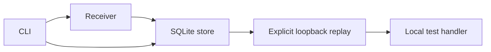

# Architecture

`store.ts` owns schema v1, atomic insert/prune and readonly queries. An internal sequence orders events even when timestamps collide; body remains a BLOB. `headers.ts` owns the three-header allowlist, applied during capture, persistence and replay.

`receiver.ts` owns bind, byte limits and bounded shutdown; `replay.ts` validates the literal destination and handles no-redirect requests with a five-second deadline. `cli.ts` owns arguments, output and signals. `report.ts` base64-encodes explicit details.

Synchronous SQLite keeps local transactions simple but can block Node during writes. This is not a production ingestion service. Native SQLite remains experimental in the Node 24 target runtime.

Tests exercise actual DB files, HTTP streams, subprocesses and installed packages. Direct lifecycle tests run on both platforms; graceful subprocess signals are additionally checked on Unix because Windows forced kill behaves differently.
